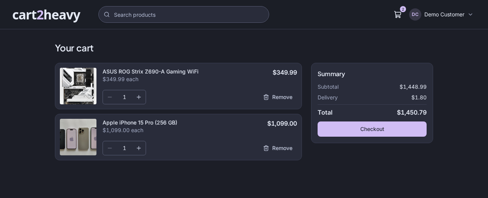
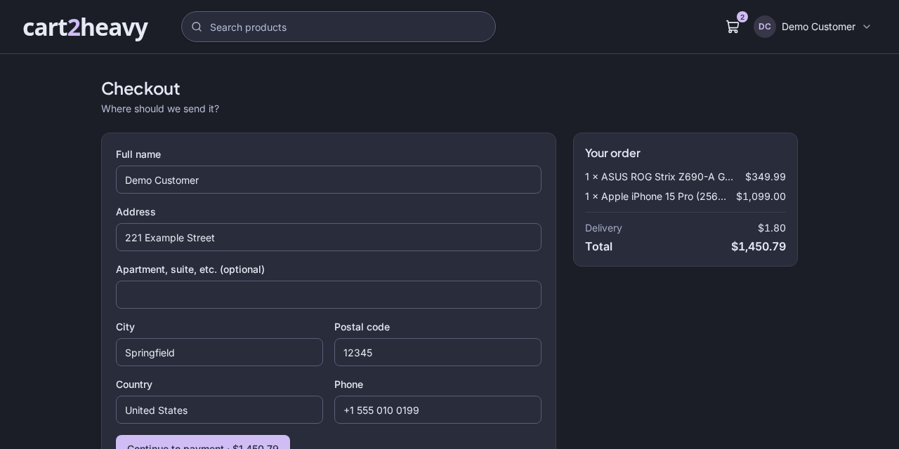
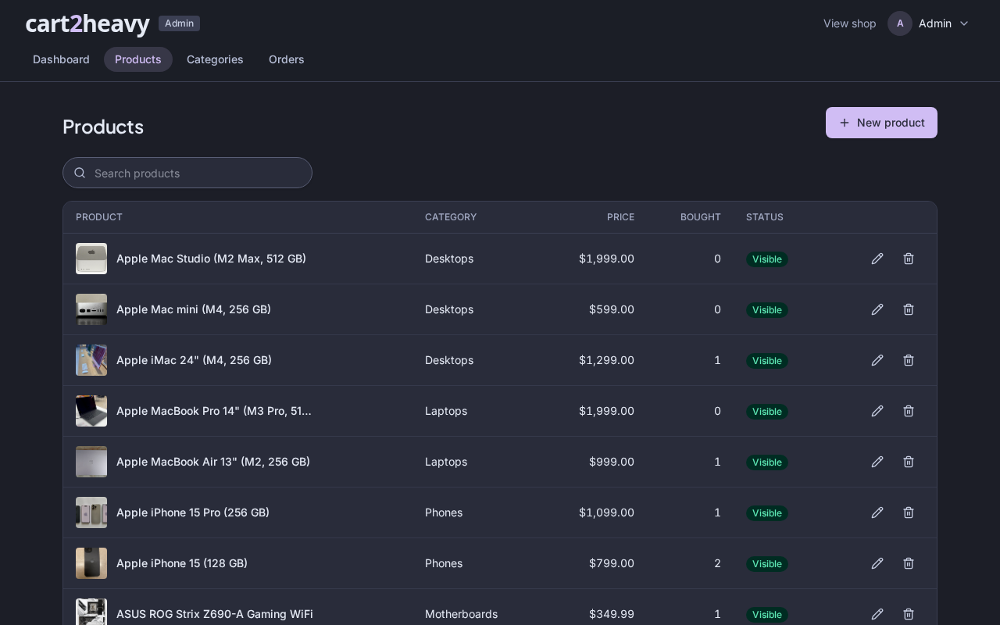
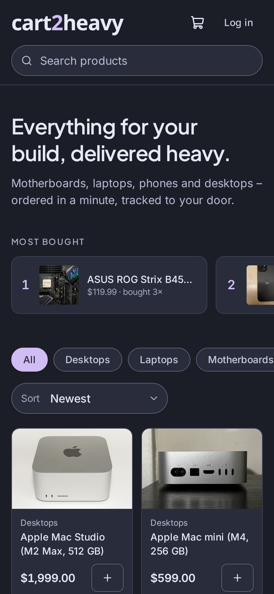
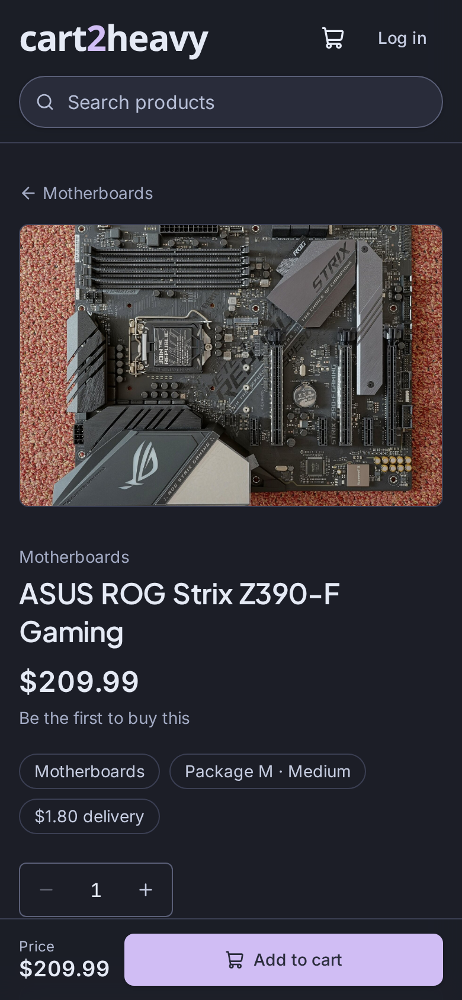
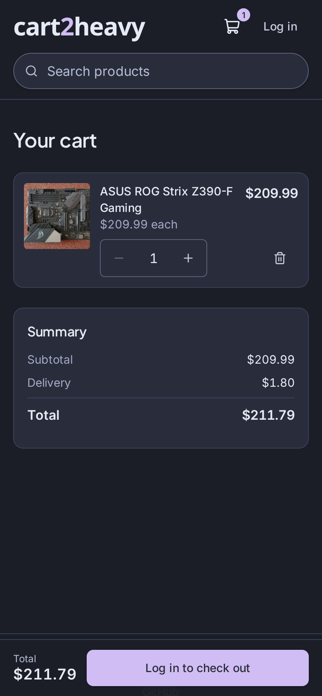
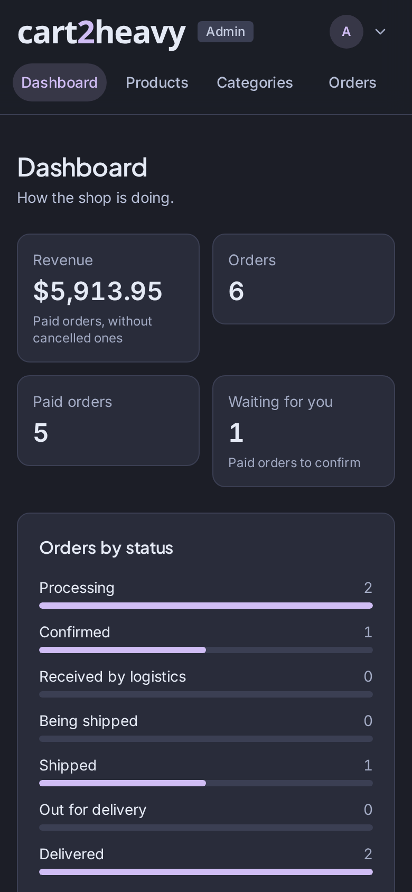
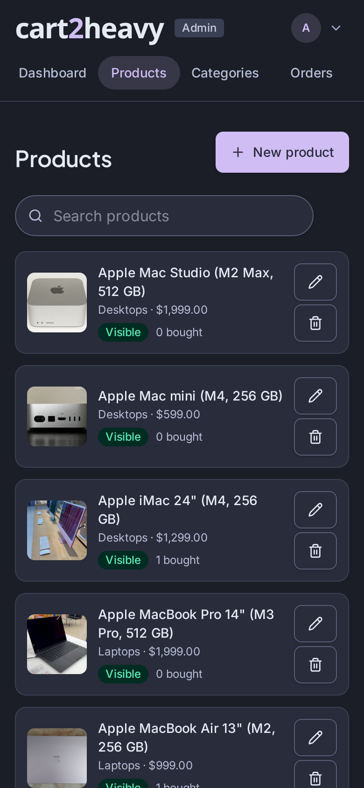
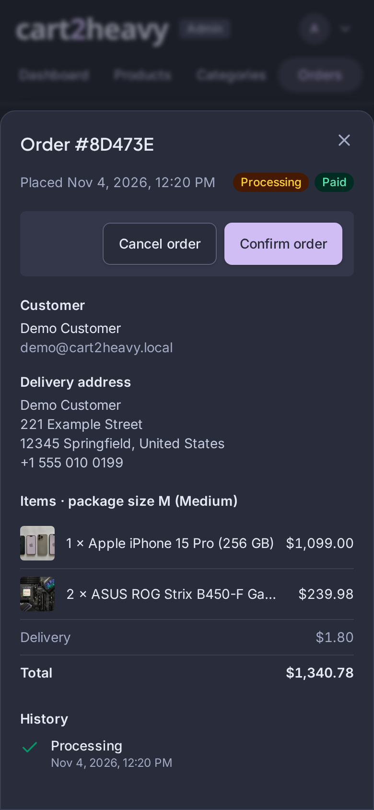
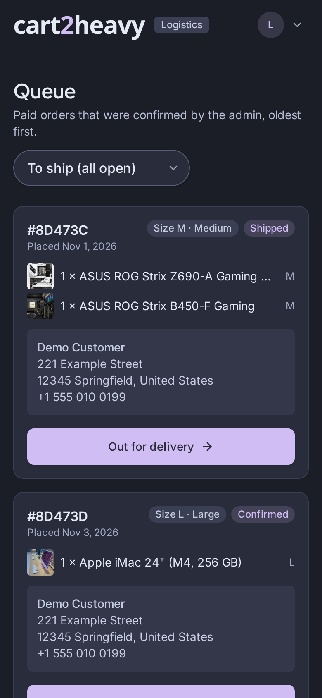

# cart2heavy

A small full-stack shop with **three roles on one order pipeline**: customers buy, the admin confirms,
logistics delivers. Written in TypeScript end to end (Express, MongoDB, React), and it runs with a
single command.


```bash
git clone https://github.com/shtmthw/cart2heavy.git
cd cart2heavy
docker compose up
```

Open **<http://localhost:8080>**. That is all: the shop comes with demo products, demo accounts and
simulated payments, so nothing needs to be configured. (Needs [Docker](https://docs.docker.com/get-docker/).)

| What                  | Where                                   |
| --------------------- | --------------------------------------- |
| Store                 | <http://localhost:8080>                 |
| Admin panel           | <http://localhost:8080/admin>           |
| Logistics panel       | <http://localhost:8080/logistics>       |
| Emails the shop sends | <http://localhost:8025> (Mailpit inbox) |

**Demo accounts** (created on the first start, local use only):

| Role      | Email                        | Password        |
| --------- | ---------------------------- | --------------- |
| Customer  | `demo@cart2heavy.local`      | `demo1234`      |
| Admin     | `admin@cart2heavy.local`     | `admin1234`     |
| Logistics | `logistics@cart2heavy.local` | `logistics1234` |

The admin account can also open the logistics panel; the logistics account only gets its own panel, and
customers get neither. Change the demo passwords (Account → Password) before anyone else can reach the site.

**Open it on your phone.** By default the shop only listens on your own computer. To try it from a phone on the same
Wi-Fi, start it with `APP_BIND=0.0.0.0` and set `APP_URL` to your computer's address, for example
`APP_BIND=0.0.0.0 APP_URL=http://192.168.1.20:8080 docker compose up` (use the address your computer has on your network). `APP_URL` is the address you type into the phone; it is used for the payment page redirect and the links in emails.

Stop with `Ctrl+C` (or `docker compose down`). Your data stays in Docker volumes; `docker compose down -v`
deletes it and the next start begins with fresh demo data.

---

## What it does

**Customers**

- Browse, filter by category, sort (newest, most popular, price) and page through the products. The
  three **most bought** products are shown on the home page.
- **Instant search**: suggestions while typing, arrow keys and Enter, plus a results page.
- A **cart** that works before logging in (it lives in the browser) and is merged into the account on
  login. Totals, delivery fee and the **$25 minimum order** are calculated on the server.
- **Checkout** with the address of the last order pre-filled, then pay. Orders get a **status
  timeline** (processing → confirmed → received → shipping → shipped → out for delivery → delivered)
  and emails for the important steps.
- Account page: name, profile photo, password.


|                                                |                                                        |
| ---------------------------------------------- | ------------------------------------------------------ |
|  |  |
|              |              |

**Admin** (`/admin`)

- Dashboard: revenue, orders per status, orders waiting for confirmation, most bought products.
- Products: create, **edit** and delete with photo upload. A product that was ordered before is hidden
  instead of deleted, so old orders keep their history.
- Categories with a **package size** (S / M / B / L). A category that still has products cannot be deleted.
- Orders: filter by status and payment, **confirm** paid orders, cancel.

|                                                          |                                                        |
| -------------------------------------------------------- | ------------------------------------------------------ |
|  |  |

**Logistics** (`/logistics`, for logistics accounts and admins)

- The queue of paid, confirmed orders with items, address and the **package size**, oldest first.
- One click moves an order to its next step (only forward, every change is recorded with who did it).


### On a phone

All three areas are built for phones (tested at 390 px wide) and follow the same rules:

- No sideways scrolling; filters and category chips scroll inside their own row.
- The main action stays under your thumb: **Add to cart**, **Checkout** and **Continue to payment** sit in a bar at the
  bottom of the screen.
- Buttons and fields are finger-sized, and text fields are 16 px so iPhones do not zoom in when you tap them.
- Admin lists (products, orders, categories) turn into cards that show price, status and actions without scrolling.
  Orders and forms open as a sheet from the bottom of the screen.
- Logistics shows one big button per order to move it to the next step.

| Shop                                                 | Product                                                    | Cart                                                 |
| ---------------------------------------------------- | ---------------------------------------------------------- | ---------------------------------------------------- |
|  |  |  |

| Admin dashboard                                                            | Admin products                                                           | Admin order                                                        | Logistics                                                      |
| -------------------------------------------------------------------------- | ------------------------------------------------------------------------ | ------------------------------------------------------------------ | -------------------------------------------------------------- |
|  |  |  |  |

---

## Look and feel

One dark theme: slate background (`#1C1E27`), lighter slate cards, a lavender accent (`#D0BDF4`), Inter for text and
Plus Jakarta Sans for headings. Pages fade in, cards lift on hover and menus and sheets ease in (animations are turned
off for people who ask their device to reduce motion). The colours live in one place, the `@theme` block of
`apps/web/src/index.css`, so changing the accent or the background is a three-line edit.

---

## Configuration

`docker compose up` works without any setup. To change something, create a file called `.env` next to
`docker-compose.yml` that contains **only the lines you want to change** (for example `PAYMENT_PROVIDER=stripe`);
Compose reads it automatically. Do not copy `.env.example` for this: it is meant for `pnpm dev` and would, among other
things, turn the demo data off and point the site at port 5173.

| Variable                | Default                           | What it does                                                                                                |
| ----------------------- | --------------------------------- | ----------------------------------------------------------------------------------------------------------- |
| `APP_PORT`              | `8080`                            | Port of the shop on your computer.                                                                          |
| `APP_BIND`              | `127.0.0.1`                       | Which address the shop and the Mailpit inbox listen on. `0.0.0.0` opens them to your network.               |
| `PAYMENT_PROVIDER`      | `mock` (`stripe` if a key is set) | `mock` = simulated payments, `stripe` = real Stripe Checkout.                                               |
| `STRIPE_SECRET_KEY`     | –                                 | Your Stripe key (`sk_test_…`). Setting it switches the shop to Stripe.                                      |
| `STRIPE_WEBHOOK_SECRET` | –                                 | Signing secret of the Stripe webhook (`whsec_…`), see below.                                                |
| `JWT_SECRET`            | generated                         | Secret that signs login sessions. Left empty, the server creates a random one and keeps it in the database. |
| `DELIVERY_FEE_CENTS`    | `180`                             | Delivery fee ($1.80), added once per order.                                                                 |
| `MIN_ORDER_CENTS`       | `2500`                            | Minimum value of the items in an order ($25.00).                                                            |
| `SEED_ON_START`         | `true` in Compose                 | Fill an **empty** database with demo data and the demo accounts.                                            |
| `MAILPIT_PORT`          | `8025`                            | Port of the email inbox.                                                                                    |

The server itself (running without Docker) understands a few more, all listed with comments in
[`.env.example`](.env.example): `MONGODB_URI`, `APP_URL`, `UPLOAD_DIR`, `SMTP_HOST` / `SMTP_PORT` /
`MAIL_FROM`, `TRUST_PROXY`, `LOG_LEVEL`. Invalid values stop the server at start-up with a message that
names every problem.

### Real payments with Stripe

1. Put your **test** key in `.env`: `STRIPE_SECRET_KEY=sk_test_...`
2. `docker compose up -d`. Checkout now sends customers to Stripe's payment page.
3. _(Recommended)_ Let Stripe tell the shop about payments even when the customer closes the tab:
   ```bash
   stripe listen --forward-to localhost:8080/api/payments/stripe/webhook
   ```
   Put the printed `whsec_…` into `STRIPE_WEBHOOK_SECRET` and restart. For a live site, add
   `https://your-domain/api/payments/stripe/webhook` as an endpoint in the Stripe dashboard
   (event `checkout.session.completed`).

Prices always go to Stripe in cents and are read from the database – never from the browser.

### Using it for real

The demo setup is meant for your own computer. Before putting it on a server:

- Put it behind HTTPS (for example a reverse proxy), set `APP_URL=https://your-domain` and `TRUST_PROXY=true`.
- Start with **`SEED_ON_START=false`**, so no demo accounts exist, and create your own staff accounts:
  ```bash
  docker compose exec app node dist/create-user.js --role admin --email you@example.com --name "Your Name"
  # roles: admin, logistics, customer. Without --password a random one is printed once.
  ```
- Point `SMTP_HOST` at a real mail server instead of Mailpit and set `STRIPE_SECRET_KEY` to take real payments.
- Back up the `mongo-data` and `uploads` volumes.

---

## Development

Needs Node.js 24+, [pnpm](https://pnpm.io/installation) and Docker (for MongoDB).

```bash
pnpm install
docker compose -f docker-compose.yml -f docker-compose.dev.yml up -d mongo mailpit   # MongoDB + email inbox
cp .env.example .env
pnpm seed        # demo data (use `pnpm seed --reset` to wipe and start over)
pnpm dev         # API on :8080, web app with hot reload on http://localhost:5173
```

| Command                                            | What it does                                                                       |
| -------------------------------------------------- | ---------------------------------------------------------------------------------- |
| `pnpm dev`                                         | API (`tsx watch`) and web app (Vite) together; Vite proxies `/api` and `/uploads`. |
| `pnpm build`                                       | Type-checks and builds the web app, then bundles the API into `apps/api/dist`.     |
| `pnpm typecheck`                                   | Strict TypeScript across all packages and the e2e tests.                           |
| `pnpm lint` / `pnpm format`                        | ESLint (typescript-eslint, React hooks) / Prettier.                                |
| `pnpm test`                                        | Unit and API tests (Vitest + Supertest on an in-memory MongoDB).                   |
| `pnpm e2e`                                         | End-to-end tests in a real browser against the Docker stack, see below.            |
| `pnpm screenshots`                                 | Regenerates the pictures in `docs/screenshots/`.                                   |
| `pnpm seed`                                        | Fills an empty database with demo data.                                            |
| `pnpm create-user --role admin --email … --name …` | Creates an account of any role.                                                    |

**Tests.** `pnpm test` covers the pricing rules, the cart, checkout and payment verification (mock
and Stripe, including the webhook), the order status rules, uploads and role permissions.
`pnpm e2e` builds the Docker image, starts a private copy of the shop (port 8081) with `docker compose`,
runs the Playwright tests (sign-up → pay → admin confirm → logistics delivers → customer sees
"Delivered", plus the emails in Mailpit) and removes it again. Install the browser once with
`pnpm exec playwright install chromium`. To test a stack that is already running:
`E2E_BASE_URL=http://localhost:8080 pnpm e2e`.

### Project structure

```
apps/
  api/            Express 5 + Mongoose + Zod
    src/config      environment validation, dotenv, session secret
    src/models      User, Category, Product, Order (money is stored as integer cents)
    src/modules     auth, users, products, categories, cart, orders, payments, admin, logistics
    src/middleware  auth + roles, same-origin check, uploads, error handler
    src/payments    PaymentGateway interface: mock.ts and stripe.ts
    src/mail        nodemailer + email templates
    src/seed        demo data (+ compressed product photos), create-user
    test/           Vitest + Supertest
  web/            React 19 + Vite + React Router + TanStack Query + Tailwind CSS 4
    src/app         router, layouts, route guards
    src/features    catalog, product, search, cart, checkout, orders, account, auth, admin, logistics
    src/components  small UI primitives (button, field, dialog, table, …)
    src/lib         API client, auth and cart hooks
packages/
  shared/         Zod schemas, DTO types, order-status rules, money helpers, cart pricing
e2e/              Playwright tests and the screenshot script
Dockerfile        one image: the API that also serves the built web app
docker-compose.yml  app + MongoDB + Mailpit
```

### How it fits together

- **One image, one port.** The API serves the built React app, so there is no CORS and no hard-coded
  URL. The login lives in an `httpOnly`, `SameSite=Lax` cookie; state-changing requests must also come
  from the same origin.
- **The server decides about money.** The browser only says _which_ products and _how many_. Prices,
  delivery, the minimum order and totals are computed from the database (`packages/shared/src/pricing.ts`),
  in integer cents.
- **Checkout is safe to repeat.** An order is created _before_ payment, the cart is kept, and the
  order is marked paid only after the payment provider confirms it (when the customer returns, or via
  the Stripe webhook). Marking paid happens exactly once, so refreshes and webhook retries cannot
  double-count the "most bought" numbers or send two emails.

  ```
  cart ─► POST /api/orders/checkout ─► payment page (Stripe, or the built-in test page)
                                         │
          POST /api/orders/:id/verify ◄──┘  asks the provider "was it paid?"
             paid   → order paid · cart emptied · sales counted · "order received" email
             unpaid → order stays unpaid · cart kept · "try again" button
  ```

- **Roles are enforced on the server.** `customer`, `admin` and `logistics` accounts. The admin endpoints
  are for admins only; the logistics endpoints are for logistics accounts and admins. Everyone else gets 403
  (the UI hiding things is only a convenience).
  Public sign-up can only create customers.
- **Uploads** are checked by MIME type, extension _and_ file signature, limited to 5 MB and stored under
  random names.

---

## Publishing the image

Maintainers publish a multi-architecture image (Intel/AMD and Apple Silicon) to Docker Hub. No CPU
emulation is needed because only the build stages run, on the build machine's own architecture:

```bash
docker buildx build --platform linux/amd64,linux/arm64 \
  -t matthew552/cart2heavy:1.0.0 -t matthew552/cart2heavy:latest --push .
```

`docker compose up` uses `matthew552/cart2heavy:latest` (pulled from Docker Hub, or built from the
checkout when it is not there); `docker compose up --build` always builds the image from the checkout.

## Photo credits

The demo product photos come from [Wikimedia Commons](https://commons.wikimedia.org/) and keep their
original licenses. Exact photos of some products are not available under a free license, so a few show
a close relative of the product (for example the ASUS boards are older ROG Strix models). Replace any of
them in the admin panel (Products → Edit).

| Product photo         | Source                                                                                                                                                                    | Author             | License       |
| --------------------- | ------------------------------------------------------------------------------------------------------------------------------------------------------------------------- | ------------------ | ------------- |
| ASUS ROG Strix B450-F | [Asus ROG Strix B450-F with AMD Ryzen 3.jpg](https://commons.wikimedia.org/wiki/File:Asus_ROG_Strix_B450-F_with_AMD_Ryzen_3.jpg)                                          | Oligopolism        | CC0           |
| ASUS ROG Strix Z690-A | [2023 Płyta główna Asus ROG STRIX Z690-A GAMING WIFI.jpg](https://commons.wikimedia.org/wiki/File:2023_P%C5%82yta_g%C5%82%C3%B3wna_Asus_ROG_STRIX_Z690-A_GAMING_WIFI.jpg) | Jacek Halicki      | CC BY-SA 4.0  |
| ASUS ROG Strix Z390-F | [Asus-ROG-Strix-Z390-F-Gaming-Motherboard 20201120 DSC6025.jpg](https://commons.wikimedia.org/wiki/File:Asus-ROG-Strix-Z390-F-Gaming-Motherboard_20201120_DSC6025.jpg)    | PantheraLeo1359531 | CC BY 4.0     |
| ASUS ROG Strix Z390-H | [Asus ROG Strix Z390-H motherboard.JPG](https://commons.wikimedia.org/wiki/File:Asus_ROG_Strix_Z390-H_motherboard.JPG)                                                    | MKFI               | Public domain |
| ASUS ROG Strix Z490-I | [ASUS ROG STRIX Z490-I GAMING.png](https://commons.wikimedia.org/wiki/File:ASUS_ROG_STRIX_Z490-I_GAMING.png)                                                              | ASUS               | CC BY-SA 4.0  |
| iPhone 15             | [Back of iPhone 15.jpg](https://commons.wikimedia.org/wiki/File:Back_of_iPhone_15.jpg)                                                                                    | ThePhotoGraphIc    | CC BY-SA 4.0  |
| iPhone 15 Pro         | [Apple iPhone 15 Pro.jpg](https://commons.wikimedia.org/wiki/File:Apple_iPhone_15_Pro.jpg)                                                                                | IPHONE 15          | CC BY-SA 4.0  |
| MacBook Air           | [MacBook Air (A2681) front.jpg](<https://commons.wikimedia.org/wiki/File:MacBook_Air_(A2681)_front.jpg>)                                                                  | メイド理世         | CC BY-SA 4.0  |
| MacBook Pro 14"       | [M3 Macbook Pro 14 inch Space Grey model.jpg](https://commons.wikimedia.org/wiki/File:M3_Macbook_Pro_14_inch_Space_Grey_model.jpg)                                        | Kyu3a              | CC BY-SA 4.0  |
| iMac 24"              | [IMac M4 2024.jpg](https://commons.wikimedia.org/wiki/File:IMac_M4_2024.jpg)                                                                                              | Seasider53         | CC BY 4.0     |
| Mac mini              | [Mac mini (M4, 2024) - Backside.jpg](<https://commons.wikimedia.org/wiki/File:Mac_mini_(M4,_2024)_-_Backside.jpg>)                                                        | AzureSaturn        | CC0           |
| Mac Studio            | [Mac Studio (2022) front.jpg](<https://commons.wikimedia.org/wiki/File:Mac_Studio_(2022)_front.jpg>)                                                                      | Yasu (talk)        | CC BY-SA 3.0  |

---

Made and founded by [Matthew Baroi](https://github.com/shtmthw)
