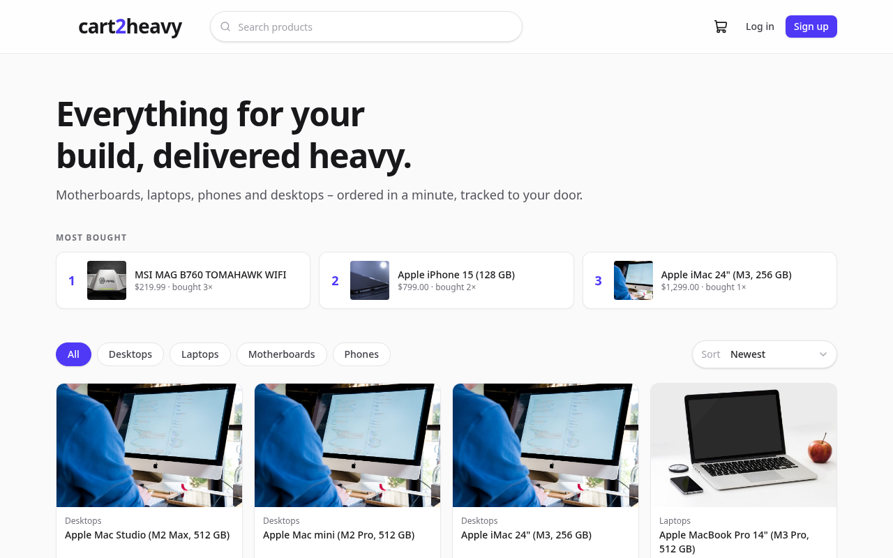
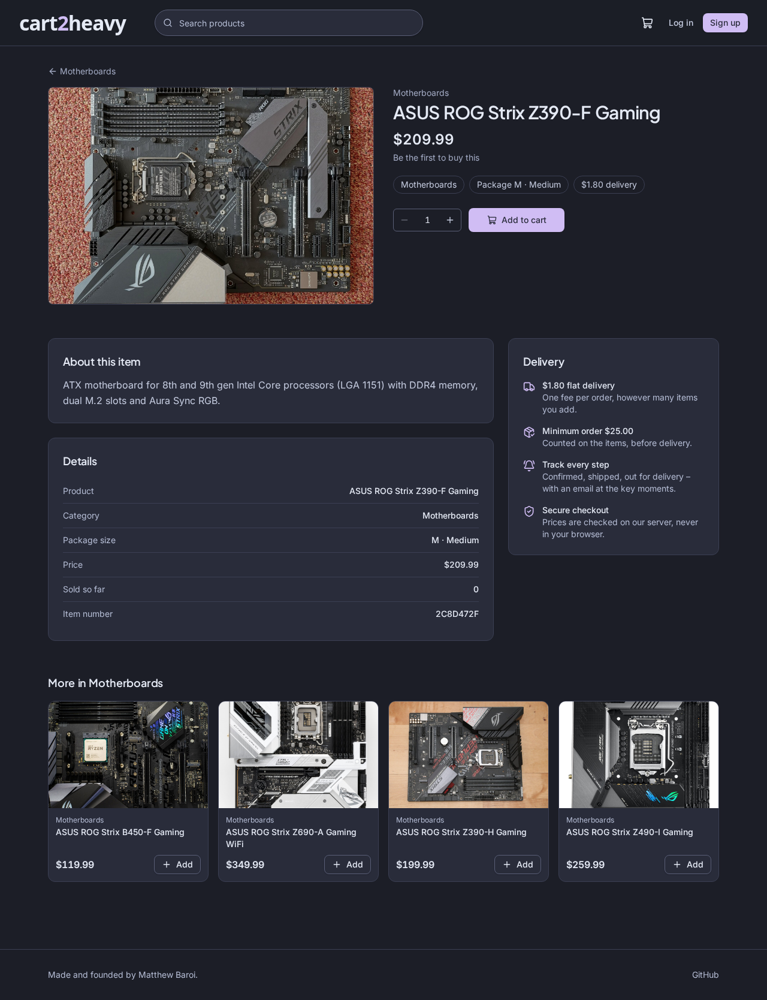
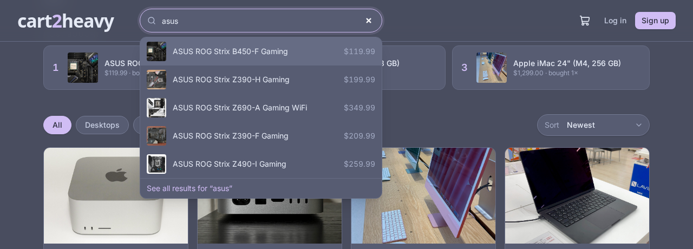
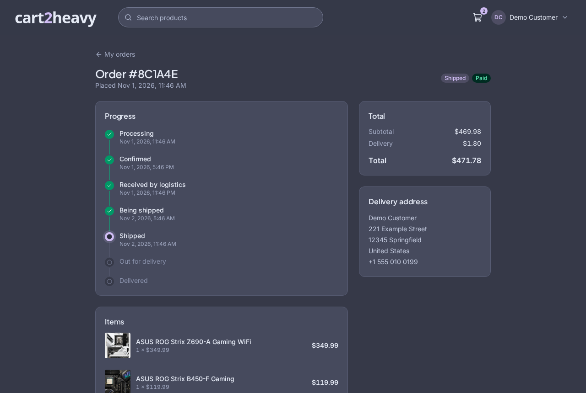
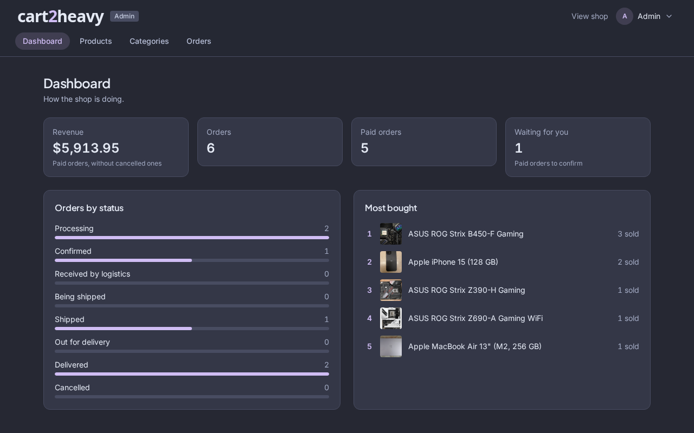
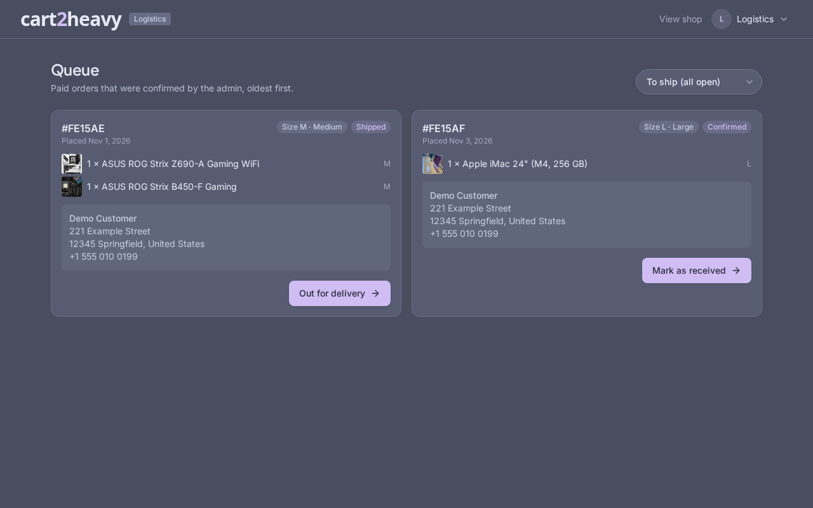

# cart2heavy

A full-stack shop with three roles working through one order pipeline: customers buy, admins confirm orders, and logistics handles delivery.

Built with TypeScript, Express, MongoDB, and React. Get it running with a single command.



## Getting started

**Requirements:** [Docker](https://docs.docker.com/get-docker/) with Docker Compose.

```bash
git clone https://github.com/shtmthw/cart2heavy.git
cd cart2heavy
docker compose up
```

Open **http://localhost:8080**.

The default setup includes demo products, demo accounts, and simulated payments. No additional configuration is required.

### Application URLs

| Area | URL |
|---|---|
| Store | http://localhost:8080 |
| Admin panel | http://localhost:8080/admin |
| Logistics panel | http://localhost:8080/logistics |
| Email inbox | http://localhost:8025 |

### Demo accounts

These accounts are created automatically when the database is first initialized with demo data.

| Role | Email | Password |
|---|---|---|
| Customer | `demo@cart2heavy.local` | `demo1234` |
| Admin | `admin@cart2heavy.local` | `admin1234` |
| Logistics | `logistics@cart2heavy.local` | `logistics1234` |

The admin account can access both the admin and logistics panels. Logistics accounts can only access the logistics panel. Customers cannot access either.

**Change the demo passwords before allowing anyone else to access your installation.**

### Your own admin account

Create it with the `create-user` command. It works on a running shop at any time:

```bash
# with Docker
docker compose exec app node dist/create-user.js --role admin --email you@example.com --name "Your Name" --password "your-password"

# from a source checkout (pnpm dev)
pnpm create-user --role admin --email you@example.com --name "Your Name" --password "your-password"
```

Roles are `admin`, `logistics` and `customer`. Without `--password`, a random password is generated and printed once. An admin can use both the admin and logistics panels. Signing up on the site always creates a customer, and there is no screen to change roles, so `create-user` is how you get a staff account (see also [Creating accounts](#creating-accounts)).

> The demo data also creates the maintainer's own admin account (`mathiwasbaroi@gmail.com`). If you run the shop for yourself, delete it or start with `SEED_ON_START=false`.

### Access from other devices

By default, the application only listens on your computer.

To access it from another device on the same network, such as a phone, set `APP_BIND` to `0.0.0.0` and `APP_URL` to your computer's local network address:

```bash
APP_BIND=0.0.0.0 APP_URL=http://192.168.1.20:8080 docker compose up
```

Replace `192.168.1.20` with your computer's actual local IP address.

`APP_URL` is used for payment redirects and links included in emails.

### Stopping the application

Press `Ctrl+C` or run:

```bash
docker compose down
```

Your data is stored in Docker volumes and survives normal shutdowns.

To remove all application data and start fresh:

```bash
docker compose down -v
```

This permanently deletes the database and uploaded files.

---

## Features

### Customer storefront

- Browse products, filter by category, sort by newest, popularity, or price, and navigate through paginated results.
- Instant search with suggestions, keyboard navigation, and a dedicated results page.
- Shopping cart that works without an account and merges into the customer's account after login.
- Server-side pricing, delivery fee calculation, and a $25 minimum order.
- Checkout with the previous delivery address automatically filled in.
- Order tracking with a status timeline and email notifications.
- Account management for name, profile photo, and password.



**Search and order tracking**

| Instant search | Order timeline |
|---|---|
|  |  |

### Admin panel

Available at `/admin`.

- Dashboard with revenue, order statistics, pending confirmations, and popular products.
- Create, edit, and delete products, including photo uploads.
- Previously ordered products are hidden instead of permanently deleted, preserving order history.
- Manage categories and their package sizes (S / M / B / L).
- Filter orders by status and payment.
- Confirm paid orders or cancel orders.



### Logistics panel

Available at `/logistics`.

- View paid and confirmed orders in chronological order.
- See order items, delivery addresses, and package sizes.
- Advance orders through their delivery stages with a single action.
- Every status change is recorded along with the person who made it.



### Mobile support

The storefront, admin panel, and logistics panel are designed to work on mobile devices.

- Responsive layouts without horizontal page scrolling.
- Touch-friendly controls and forms.
- Bottom action bars for important checkout and shopping actions.
- Admin tables adapt into mobile-friendly cards.
- Logistics provides a large, accessible action for advancing each order.


## Configuration

The default Docker setup works without an `.env` file.

To customize it, create a file named `.env` next to `docker-compose.yml` and add only the variables you want to override.

For example:

```env
PAYMENT_PROVIDER=stripe
STRIPE_SECRET_KEY=sk_test_your_key
```

Docker Compose reads this file automatically.

Do not copy `.env.example` for the Docker setup. That file is intended for running the application outside Docker and contains development-oriented defaults.

### Environment variables

| Variable | Default | Description |
|---|---|---|
| `APP_PORT` | `8080` | Port exposed by the application. |
| `APP_BIND` | `127.0.0.1` | Network address the application and Mailpit listen on. Use `0.0.0.0` to allow network access. |
| `PAYMENT_PROVIDER` | `mock` | Payment provider: `mock` for simulated payments or `stripe` for real Stripe Checkout. |
| `STRIPE_SECRET_KEY` | — | Stripe secret key (`sk_test_...` or a live key). |
| `STRIPE_WEBHOOK_SECRET` | — | Stripe webhook signing secret (`whsec_...`). |
| `JWT_SECRET` | Generated | Secret used to sign authentication sessions. If omitted, the server generates one and stores it in the database. |
| `DELIVERY_FEE_CENTS` | `180` | Delivery fee in cents. Default: $1.80. |
| `MIN_ORDER_CENTS` | `2500` | Minimum order value in cents. Default: $25.00. |
| `SEED_ON_START` | `true` | Populate an empty database with demo data and accounts. |
| `MAILPIT_PORT` | `8025` | Port for the local email inbox. |

Other server configuration options are documented in `.env.example`, including database connection, application URL, file uploads, SMTP, proxy, and logging settings.

Invalid configuration values cause the server to stop at startup and report the problems.


## Payments

### Simulated payments

The default payment provider is `mock`.

It allows you to test the complete order workflow without a Stripe account or real transactions.

### Stripe Checkout

To enable real Stripe payments:

1. Create a Stripe account at [stripe.com](https://stripe.com/).
2. Add your Stripe test secret key to `.env`:

   ```env
   PAYMENT_PROVIDER=stripe
   STRIPE_SECRET_KEY=sk_test_your_key
   ```

3. Start or restart the application:

   ```bash
   docker compose up -d
   ```

4. Configure Stripe webhooks so the application can receive payment notifications even when customers close the checkout page.

For local testing, install the [Stripe CLI](https://docs.stripe.com/stripe-cli) and run:

```bash
stripe listen --forward-to localhost:8080/api/payments/stripe/webhook
```

Copy the generated `whsec_...` value into `.env`:

```env
STRIPE_WEBHOOK_SECRET=whsec_your_secret
```

Restart the application after changing the configuration.

For a live deployment, register this endpoint in your Stripe dashboard:

```text
https://your-domain/api/payments/stripe/webhook
```

Subscribe to:

```text
checkout.session.completed
```

Payment amounts are calculated from the server-side database, not supplied by the browser.


## Production deployment

The default configuration is intended for local demonstrations and testing. Before exposing the application publicly:

1. Put the application behind HTTPS, using a reverse proxy.
2. Set `APP_URL` to your public HTTPS address.
3. Set `TRUST_PROXY=true` when operating behind a trusted reverse proxy.
4. Set `SEED_ON_START=false` to prevent demo accounts and data from being created.
5. Create your own administrator and staff accounts.
6. Configure a real SMTP server instead of relying on Mailpit.
7. Configure Stripe with your live payment credentials.
8. Back up the `mongo-data` and `uploads` Docker volumes regularly.

## Photo credits

The demo product photos come from [Wikimedia Commons](https://commons.wikimedia.org/) and retain their original licenses.

Some exact product photos are not available under a suitable free license. In those cases, a similar product is used instead. For example, some ASUS motherboard images depict older ROG Strix models.

Product images can be replaced from the admin panel under **Products → Edit**.

| Product | Source | Author | License |
|---|---|---|---|
| ASUS ROG Strix B450-F | [Wikimedia Commons](https://commons.wikimedia.org/wiki/File:Asus_ROG_Strix_B450-F_with_AMD_Ryzen_3.jpg) | Oligopolism | CC0 |
| ASUS ROG Strix Z690-A | [Wikimedia Commons](https://commons.wikimedia.org/wiki/File:2023_P%C5%82yta_g%C5%82%C3%B3wna_Asus_ROG_STRIX_Z690-A_GAMING_WIFI.jpg) | Jacek Halicki | CC BY-SA 4.0 |
| ASUS ROG Strix Z390-F | [Wikimedia Commons](https://commons.wikimedia.org/wiki/File:Asus-ROG-Strix-Z390-F-Gaming-Motherboard_20201120_DSC6025.jpg) | PantheraLeo1359531 | CC BY 4.0 |
| ASUS ROG Strix Z390-H | [Wikimedia Commons](https://commons.wikimedia.org/wiki/File:Asus_ROG_Strix_Z390-H_motherboard.JPG) | MKFI | Public domain |
| ASUS ROG Strix Z490-I | [Wikimedia Commons](https://commons.wikimedia.org/wiki/File:ASUS_ROG_STRIX_Z490-I_GAMING.png) | ASUS | CC BY-SA 4.0 |
| iPhone 15 | [Wikimedia Commons](https://commons.wikimedia.org/wiki/File:Back_of_iPhone_15.jpg) | ThePhotoGraphIc | CC BY-SA 4.0 |
| iPhone 15 Pro | [Wikimedia Commons](https://commons.wikimedia.org/wiki/File:Apple_iPhone_15_Pro.jpg) | IPHONE 15 | CC BY-SA 4.0 |
| MacBook Air | [Wikimedia Commons](https://commons.wikimedia.org/wiki/File:MacBook_Air_(A2681)_front.jpg) | メイド理世 | CC BY-SA 4.0 |
| MacBook Pro 14" | [Wikimedia Commons](https://commons.wikimedia.org/wiki/File:M3_Macbook_Pro_14_inch_Space_Grey_model.jpg) | Kyu3a | CC BY-SA 4.0 |
| iMac 24" | [Wikimedia Commons](https://commons.wikimedia.org/wiki/File:IMac_M4_2024.jpg) | Seasider53 | CC BY 4.0 |
| Mac mini | [Wikimedia Commons](https://commons.wikimedia.org/wiki/File:Mac_mini_(M4,_2024)_-_Backside.jpg) | AzureSaturn | CC0 |
| Mac Studio | [Wikimedia Commons](https://commons.wikimedia.org/wiki/File:Mac_Studio_(2022)_front.jpg) | Yasu (talk) | CC BY-SA 3.0 |

---

Made and founded by [Matthew Baroi](https://github.com/shtmthw).
